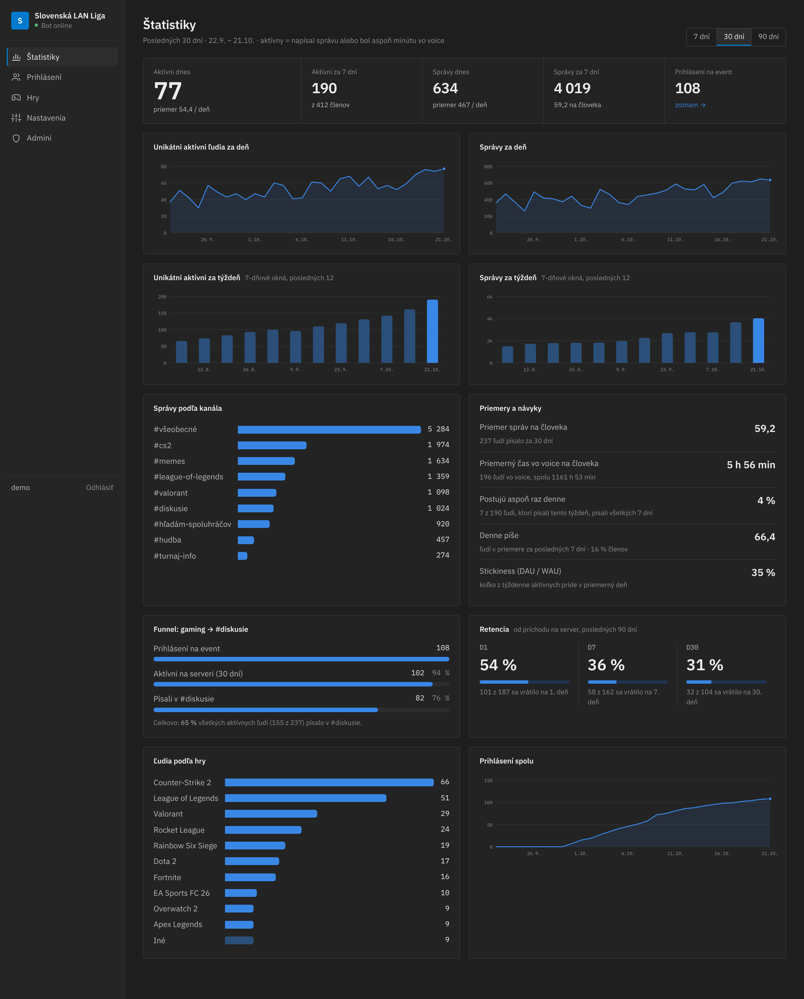
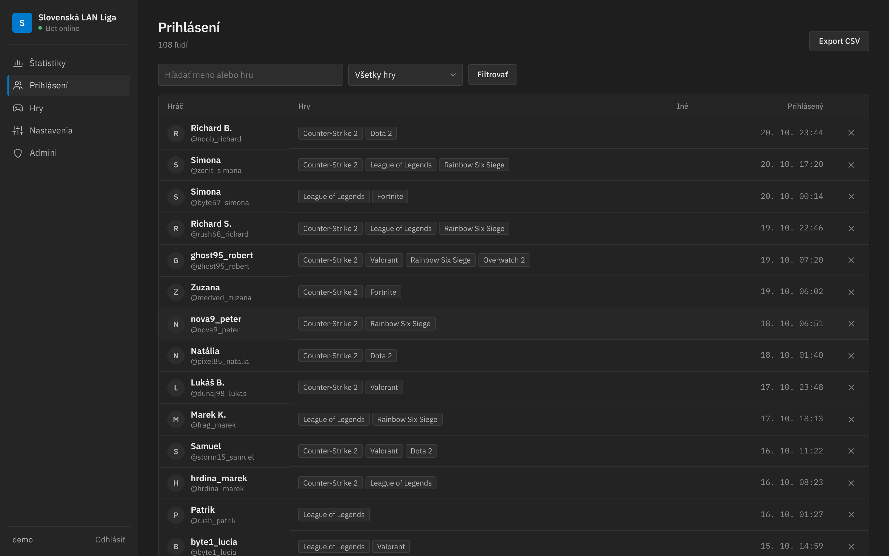
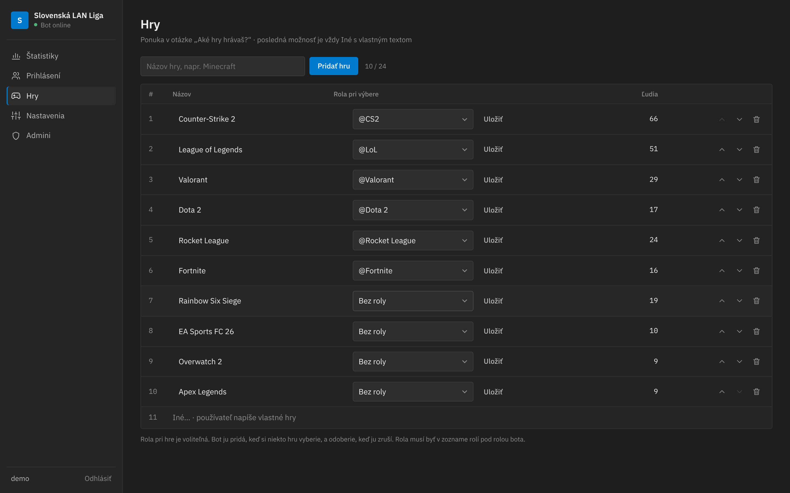
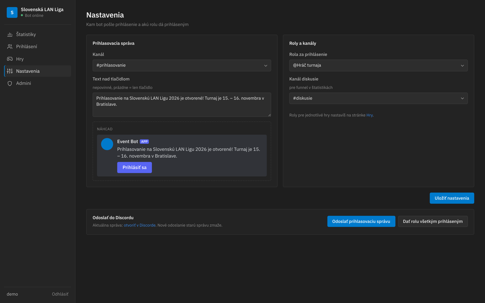
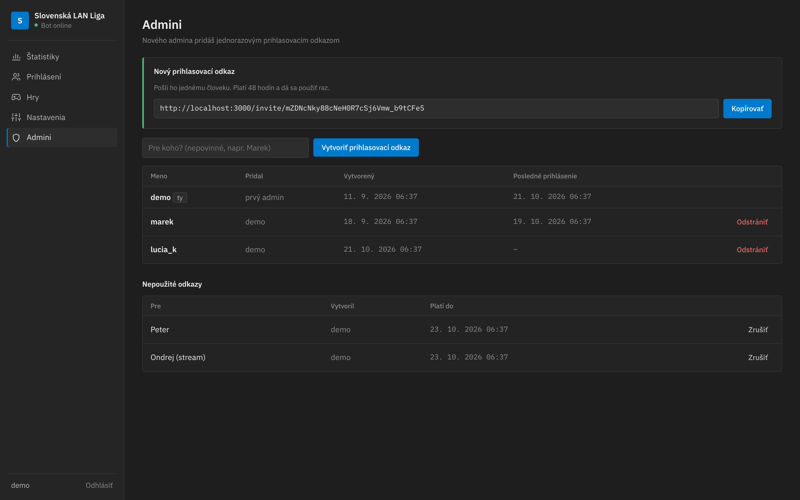

# Event Signup Bot

A Discord bot for gaming-event signups, plus a web admin panel with server statistics.

- The bot posts a message with a **Prihlásiť sa** button to a channel you pick in the panel.
- Clicking it asks **„Aké hry hrávaš?“** with the games from the panel, plus **Iné…**, where people type their own games.
- People who sign up get the **signup role**. Each game can also have its own role.
- The panel shows the signup list (filter, search, CSV export) and server analytics.
- Admins log in with a name and password. The first admin creates one-time **login links** for everyone else.



| Prihlásení | Hry |
|---|---|
|  |  |
| **Nastavenia** | **Admini** |
|  |  |

## Statistics

| Metric | How it is counted |
|---|---|
| Unique active users / day, / week | A user is active on a day when they sent a message or spent at least 1 minute in voice (AFK channel and deafened users don't count) |
| Total messages / day, / week | All messages from non-bot users. Messages in threads count toward the parent channel |
| Messages / channel | Over the selected range (7 / 30 / 90 days) |
| Average messages / user | Messages ÷ people who wrote at least once in the range |
| Average voice time / user | Voice time ÷ people who were in voice in the range |
| % in #diskusie (gaming → politics funnel) | Signed-up players → active on the server → wrote in the discussion channel. The channel is picked in Settings |
| % posting at least once a day | Of people who wrote in the last 7 days, the share who wrote on all 7 days. Also shows average daily posters |
| D1 / D7 / D30 retention | Of people who joined in the last 90 days, the share active exactly 1 / 7 / 30 days after joining |
| People per game role | Signups per game, plus "Iné" |

Only counts are stored (day, user, channel, number of messages). Message content is never read or saved.
Data collection starts when the bot is first added, so there is no history from before that.

## Setup

Needs **Node.js 22.13 or newer** (uses the built-in SQLite, so there's nothing to compile).

1. In the [Discord Developer Portal](https://discord.com/developers/applications) create an application → **Bot**.
   - Copy the token.
   - Turn on **Server Members Intent** (used for join dates and retention). If you don't want it, set `MEMBERS_INTENT=false`.
   - Message Content Intent is **not** needed.
2. Invite the bot with the `bot` scope and these permissions: View Channels, Send Messages, Read Message History, Manage Roles.
   In the server's role list, drag the bot's role **above** the signup role and the game roles, or it can't assign them.
3. Configure and start:
   ```sh
   npm install
   cp .env.example .env   # fill in DISCORD_TOKEN, GUILD_ID, PUBLIC_URL
   npm start
   ```
4. On first start the console prints a one-time link `…/setup/<token>`. Open it and create the first admin.
5. In **Nastavenia** pick the signup channel, the signup role and the discussion channel, save, then press **Odoslať prihlasovaciu správu**.
6. Under **Admini**, create login links for other admins. Each link works once and expires after 48 hours.

Put the panel behind HTTPS before using it on the internet (any reverse proxy). Set `PUBLIC_URL` to the `https://` address so cookies are marked secure.

## Demo without Discord

```sh
npm run demo           # http://localhost:3000, login demo / demo-heslo-123
npm run screenshots    # writes screenshots/*.png (in another terminal, with the demo running)
```

The demo runs the panel against a fake server with generated activity, stored in `data/demo.db`.

## Layout

```
src/
  index.js        starts the bot and the panel
  bot.js          Discord client: signup flow, roles, message/voice tracking
  store.js        games, signups, activity counters
  stats.js        analytics queries
  db.js           SQLite schema and settings
  web/            Express panel: auth, routes, EJS views, CSS, SVG charts
scripts/demo.js   fake server + generated data
```
